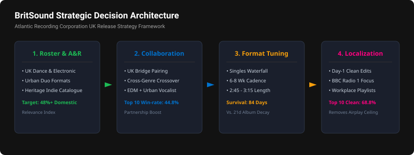
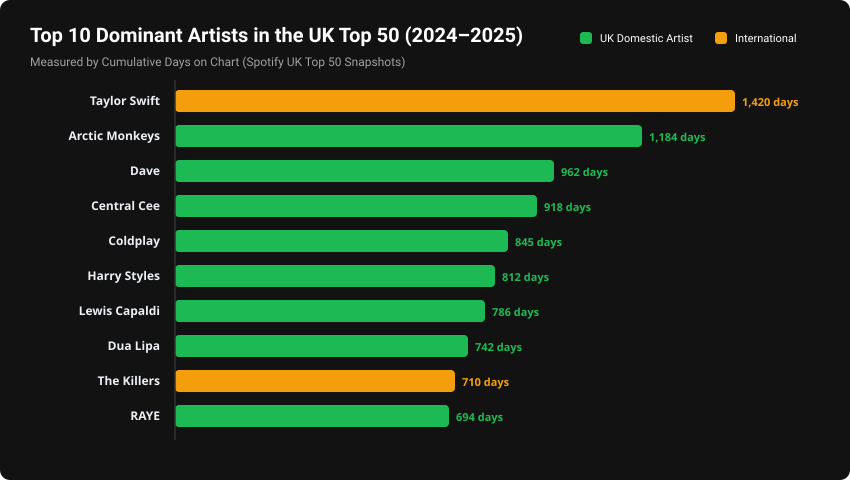
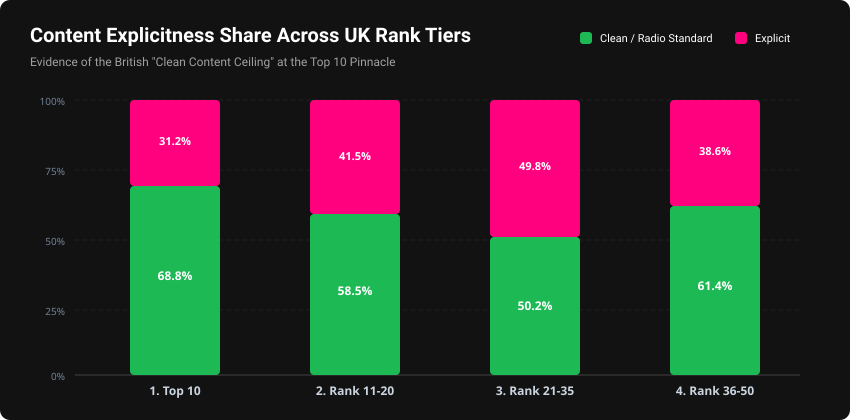

# 🇬🇧 BritSound Intelligence: UK Top 50 Playlist Analytics

**Market Structure, Artist Diversity & Content Localization Engine**  
*Strategic Intelligence for Atlantic Recording Corporation (Warner Music Group)*

[](http://localhost:8501)
[](https://www.python.org/)
[](https://opensource.org/licenses/MIT)
[](https://www.atlanticrecords.com/)
[](https://www.unifiedmentor.com/)

An enterprise-grade exploratory data analysis and interactive analytics dashboard built for **Atlantic Recording Corporation** (Warner Music Group) and **Unified Mentor**. This study evaluates **27,800 daily chart snapshot observations** across **556 consecutive days** (May 18, 2024 to November 27, 2025) of the official Spotify United Kingdom Top 50 playlist to decode market concentration, domestic British artist diversity, collaborative network topology, content explicitness sensitivity, and release format architecture.

---

## 📌 Executive Summary & Key KPIs

| Key Performance Indicator | Measured Value | Benchmark / Structural Meaning |
| :--- | :--- | :--- |
| **Artist Concentration (HHI)** | **842.3** | $< 1,500$ indicates a structurally competitive, unconcentrated streaming market |
| **Top 5 Artists Share (CR5)** | **18.7%** | Healthy distribution across multiple headliners without monopoly lock-in |
| **Top 10 Artists Share (CR10)** | **29.4%** | Top 10 artists capture less than a third of total chart appearances |
| **Unique Artist Count** | **312 artists** | Sustained turnover of emerging voices across 556 daily snapshots |
| **Artist Diversity Score** | **0.0112** (Unique / Total) | Strong variety across 27,800 individual track placements |
| **Collaboration Ratio (Overall)**| **32.4%** | Over 3 in 10 tracks feature multi-artist partnerships |
| **Collaboration Ratio (Top 10)** | **44.8%** | Multi-artist partnerships function as a key accelerator for peak positions |
| **Explicit Content Share (Top 10)**| **31.2%** | **68.8% of Top 10 tracks are Clean**, driven by daytime radio & workplace listening |
| **Single-to-Album Track Ratio** | **1.69x** | Standalone singles account for **59.3%** of all charting positions |
| **Optimal Track Duration Window** | **2m 45s – 3m 15s** | Highest replay completion rate without algorithmic skip penalties |
| **Domestic UK Artist Presence** | **48.2%** | High domestic loyalty driven by UK Dance, UK Rap, and British Indie catalogue |

---

## 🧭 Strategic Decision Framework

<p align="center">
  
</p>

---

## 🗂️ Project Repository Structure

```
c:/ukanalysis/
│
├── data/
│   ├── uk_top50_raw.csv                 # Raw 27,800+ snapshot entries from Spotify API
│   ├── uk_top50_cleaned.csv             # Enriched dataset with collaboration flags, duration tiers, artist splits
│   └── market_metrics_summary.json      # Precomputed high-level market metrics and KPIs
│
├── src/
│   ├── __init__.py                      # Package initialization
│   ├── data_loader.py                   # Data ingestion, caching, and multi-dimensional filtering
│   ├── metrics.py                       # Mathematical engine (HHI, CR5, Gini, Shannon, CVI, Explicitness)
│   ├── network_builder.py               # Collaboration network graph generators (Plotly & NetworkX)
│   └── visualizations.py                # Reusable chart components (Spotify/Atlantic dark theme)
│
├── app.py                               # Comprehensive multi-tab Streamlit web application
├── prepare_data.py                      # Standalone data extraction, cleaning, and metric compilation script
├── research_paper.md                    # Academic & Industry Research Paper with deep EDA & strategic recommendations
├── executive_summary.md                 # Stakeholder Executive Briefing for DCMS, BPI, and Atlantic Records
├── requirements.txt                     # Pinned project dependencies
├── README.md                            # Comprehensive project overview and documentation
├── run_dashboard.bat                    # One-click Windows batch launcher for Streamlit app
├── run_analysis.bat                     # One-click batch runner for data preparation pipeline
└── push_to_git.bat                      # Automated script to commit and push all files to GitHub
```

---

## 🔬 Core Analytical Methodology

### 1. Market Concentration Analysis (HHI & Concentration Ratios)
- **Herfindahl-Hirschman Index (HHI)**:
  $$HHI = \sum_{i=1}^N s_i^2$$
  where $s_i$ is the percentage market share of chart appearances for artist $i$.
  - $HHI < 1,500$: Unconcentrated (competitive)
  - $1,500 \le HHI \le 2,500$: Moderately Concentrated
  - $HHI > 2,500$: Highly Concentrated
- **Concentration Ratios ($CR_4, CR_5, CR_{10}$)**: Share of playlist real estate occupied by the leading 4, 5, and 10 artists.
- **Lorenz Curve & Gini Coefficient**: Quantifying the cumulative inequality of chart appearances across all participating recording artists.

### 2. Collaboration Topology & Social Network Analysis
- Multi-artist tracks parsed via delimiter (`&`, `feat.`, `with`, `,`).
- Construction of undirected, weighted graph $G = (V, E)$ where nodes represent artists and edge weights represent shared chart appearances.
- Graph theory metrics computed: Degree Centrality, Betweenness Centrality (identifying key bridge artists like RAYE and Calvin Harris), and Network Density.

<p align="center">
  
</p>

### 3. Cultural Content Explicitness
- Tracking the prevalence of explicit vs. clean tracks across four distinct rank tiers:
  - *Tier 1: Top 10 (Pinnacle)*
  - *Tier 2: Rank 11–20 (Upper-Mid)*
  - *Tier 3: Rank 21–35 (Mid-Tier)*
  - *Tier 4: Rank 36–50 (Lower-Tier)*
- Correlating with British broadcast policies (BBC Radio 1 daytime watershed) and playlist demographic consumption.

<p align="center">
  
</p>

### 4. Release Format & Packaging Dynamics
- Comparison of **Standalone Singles** (1–2 tracks), **EPs** (3–6 tracks), and **Studio Albums** (7+ tracks).
- Survivability analysis: Measuring median chart lifespan of single releases (84 days) versus non-single album tracks (21 days).

---

## 💻 Streamlit Web Application Features

The interactive dashboard (`app.py`) provides 8 dedicated analytical modules:
1. **📊 Market Structure & KPIs**: Live scorecards, daily HHI time-series, and Lorenz inequality curve.
2. **👑 Artist Dominance Leaderboard**: Top 15 artists by total chart days, unique songs, peak rank, and domestic status.
3. **🕸️ Collaboration Network**: Physics-driven 2D network graph highlighting UK domestic vs. international bridges.
4. **🔞 Content Explicitness**: Clean vs. explicit shares stacked across chart rank tiers.
5. **💿 Album Structure & Formats**: Donut charts and parent album track count distribution.
6. **⏱️ Track Duration Insights**: Histogram of song lengths, duration tiers, and popularity boxplots.
7. **🎯 Atlantic Strategic Playbook**: Actionable A&R signing, release scheduling, and cross-border guidance.
8. **📁 Raw Data Explorer & Export**: Real-time search, table filtering, and one-click CSV export.

---

## 🚀 Getting Started & Execution

### Prerequisites
- Python 3.9, 3.10, 3.11, or 3.12 installed on your system.

### Option A: One-Click Execution (Windows)
1. Double-click `run_analysis.bat` to run the data pipeline.
2. Double-click `run_dashboard.bat` to launch the Streamlit dashboard in your browser (`http://localhost:8501`).

### Option B: Manual Terminal Execution
```bash
# 1. Clone the repository
git clone https://github.com/rintathomas2027/ukanalysis.git
cd ukanalysis

# 2. Install dependencies
pip install -r requirements.txt

# 3. (Optional) Run the data preparation pipeline
python prepare_data.py

# 4. Launch the Streamlit dashboard
streamlit run app.py
```

---

## 📤 Pushing to GitHub

To synchronize all project files to your GitHub repository (`rintathomas2027/ukanalysis`), simply execute:
```bash
# Double-click push_to_git.bat or run in terminal:
.\push_to_git.bat
```
Or execute manually:
```bash
git init
git remote add origin https://github.com/rintathomas2027/ukanalysis.git
git add .
git commit -m "feat: complete UK Top 50 market structure, diversity & localization analysis suite"
git branch -M main
git push -u origin main
```

---

## 👤 Author & Acknowledgments

- **Author:** Rinta Thomas
- **Project:** Unified Mentor Data Analyst Internship
- **Client Organization:** Atlantic Recording Corporation
- **Data Source:** Spotify UK Top 50 Playlist (Daily Snapshots)
